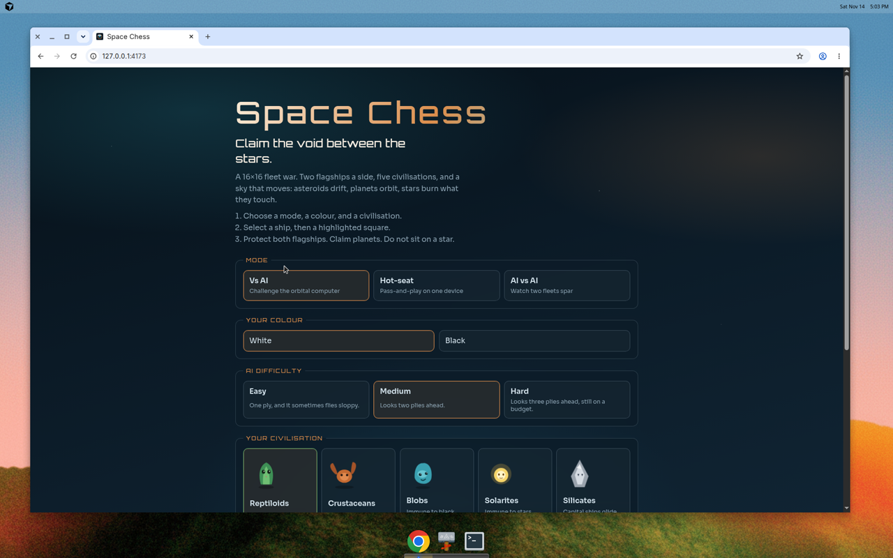
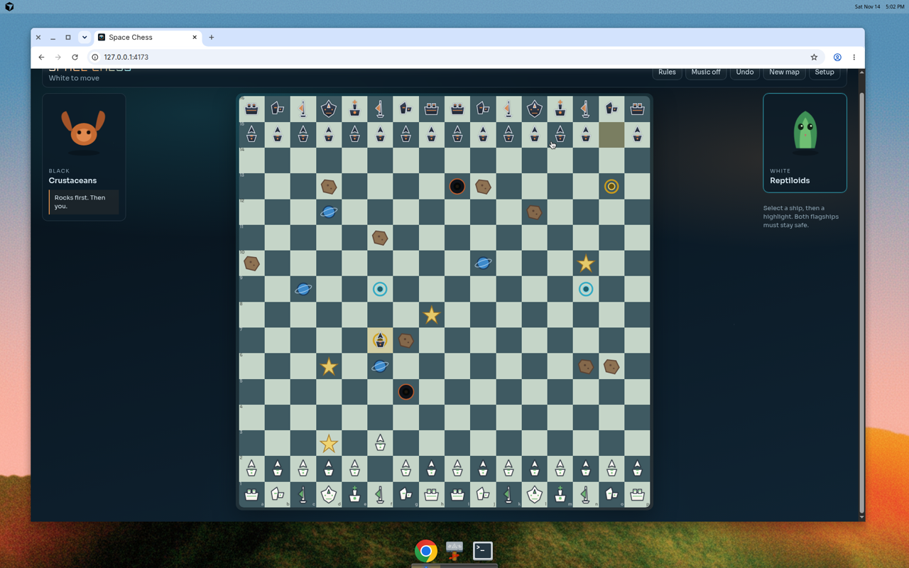

# Space Chess

A 16×16 fleet battle in a browser. Every file starts occupied, both flagships have to survive, and the sky moves after every full turn. Five civilisations, three AI difficulties, local hot-seat, and rated online play when a Supabase project is connected.





## Play locally

```bash
npm install
npm run dev
```

```bash
npm test          # rules, Elo, and the match server
npm run build     # static site in dist/, plus the match-function bundle
npm run preview   # serve the production build
```

Guest games (vs AI, hot-seat, AI vs AI) need no account. Music starts after the first click. The first launch shows a four-step briefing.

## Rated online

The browser only needs the public project URL and the anon key. The service-role key stays on the server, inside the `match` Edge Function. Copy `.env.example` to `.env`:

```
VITE_SUPABASE_URL=https://<project-ref>.supabase.co
VITE_SUPABASE_ANON_KEY=<anon key>
```

Set the same two variables on Vercel (Project → Settings → Environment Variables) and redeploy. Framework preset **Vite**, build `npm run build`, output `dist`.

The Supabase organisation behind this repo is already at its two-active-project free limit, so `space-chess` could not be created from here without pausing another project. When a slot is free:

1. Create a project named `space-chess` in `eu-central-1`.
2. Run `supabase/migrations/20261114170000_space_chess.sql` in the SQL editor. It creates `profiles` and `matches`, a private signup trigger, row level security, and the realtime publication. Clients can read the leaderboard and their matches. They cannot write Elo or match state.
3. In Authentication → Providers → Email, turn off “Confirm email” so a new pilot gets a session immediately.
4. `npm run bundle:fn`, then deploy `supabase/functions/match` with JWT verification on. The function loads the same rules engine, rejects illegal moves, and on a finished rated game applies `elo + 32 * (score - expected)`.
5. Paste the project URL and anon key into `.env` and Vercel.

Lobby flow: create a rated game and pick your civilisation, or join with the six-character code and pick yours. The board follows the match row. Resign, or claim the game after the opponent has left the clock untouched for a minute. Both go through the function.

## Rules

### The fleet

- **16×16** board. The rank in front of each back rank is 16 fighters. The back rank is the standard line twice, so all 16 files are filled: battleship, cruiser, frigate, dreadnought, flagship, frigate, cruiser, battleship, and the same again.
- The engine still calls those pieces pawn, knight, bishop, rook, queen, and king. The board shows the fleet names.
- Movement, promotion, and en passant follow chess.
- Each side has **two flagships**. A side is in check if either is attacked. A move that leaves either in check is illegal. Checkmate is no legal move while in check.
- Each flagship castles only inside its own half of the back rank (files a–h, or i–p).
- Draws: stalemate, threefold repetition, the 50-move rule, and insufficient material. A star that destroys a flagship wins the game. If one tick destroys a flagship on both sides, the game is a draw.

### Hazards

The layout is seeded, so both players see the same sky. After Black moves, every body steps once:

| Body | Movement |
|---|---|
| Asteroid | Drifts one file and bounces off the edge, a ship, or another hazard. |
| Planet | Walks a clockwise loop around its anchor and keeps its owner. |
| Star | Drifts one diagonal step. A ship it lands on is destroyed, unless that ship is a Blob or a Solarite. |
| Black hole | Stays put. The hole and every adjacent square are closed to anyone who is not a Blob. |
| Wormhole | Stays paired. Enter one, exit the other, and capture an enemy standing on the exit. |

### Civilisations

| Civ | Ability |
|---|---|
| Reptiloids | Claiming a planet spawns up to **2** allied fighters on empty adjacent squares. |
| Crustaceans | May land on an asteroid and shove it up to **3** squares toward the enemy. The shove can crush a ship. |
| Blobs | Immune to the black-hole well and to stars. Entering one black hole hops to the other and can capture. |
| Solarites | Immune to stars. Ending a move beside a star pushes orthogonally adjacent enemies one square away, when that square is empty. |
| Silicates | Battleships, frigates, and dreadnoughts are not forced to stop on an empty planet. They claim it only if they stop there. An asteroid that would crush a silicate shatters, and the silicate stays. |

A planet spawns fighters only when ownership changes.

### AI

Easy, Medium, and Hard search 1, 2, and 3 plies with node budgets of 600, 3,500, and 10,000. The search uses the same move applier, including the hazard tick, so it will not step onto a star. Easy still mixes in blunders. Against the AI, the portrait talks in canned lines. No model is called.

### Ratings

New pilots start at 1200. A rated game updates both ratings by `32 * (score - expected)`, with the usual 400-point expectation. Guest games are unrated.

## What changed from the first browser version

The first browser build kept a middle-eight army and three civilisations, and it left hazards where they spawned. This version fills the board, doubles the back rank, treats either flagship as a king, and lets asteroids, planets, and stars drift. Reptiloid spawns dropped from 3 to 2, and the crustacean shove from 4 to 3, because a full-width board was snowballing. Blobs gained a hop between the two black holes and immunity to stars, which gives the old immunity something to do every game. Solarites and Silicates are new. Ship silhouettes, portraits, a kill flash, music, a first-launch briefing, and the rated lobby are new too.

The earlier fixes still hold: castling is half-relative, non-blobs cannot enter a black-hole well, wormholes cannot land on a friend, and planet spawns do not repeat on a planet you already own.

## Stack

- TypeScript, React 19, Vite 8, Vitest
- Rules in `src/engine/` (no DOM)
- Alpha-beta in a Web Worker (`src/ai/`)
- Match actions in `src/online/server.ts`, bundled into the Edge Function
- Static `dist/` for Vercel

## Layout

```
src/engine/        rules, Elo
src/ai/            search, worker, trash talk
src/components/    board, setup, portraits, lobby
src/online/        match server and the browser client
supabase/          migration and the match function
public/audio/      music, move, capture
legacy/            original Pygame game
```

## Controls

- Select a ship, then a highlighted square
- Undo (against the AI this also takes back the reply)
- Rules, from the match bar
- Music on / off
- Rated match and Leaderboard, from the setup screen

## Known limitations

- Hard still stops at its node budget on a crowded board.
- Rated play stays dark until `space-chess` exists and the two `VITE_` variables are set. Creating that project needs a free Supabase slot.
- A disconnect claim is a full minute with no move, checked by the server. Closing the tab does not by itself stop the clock.
- The service-role key must never be added to Vite or Vercel.
